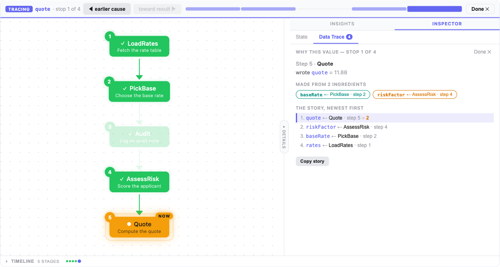
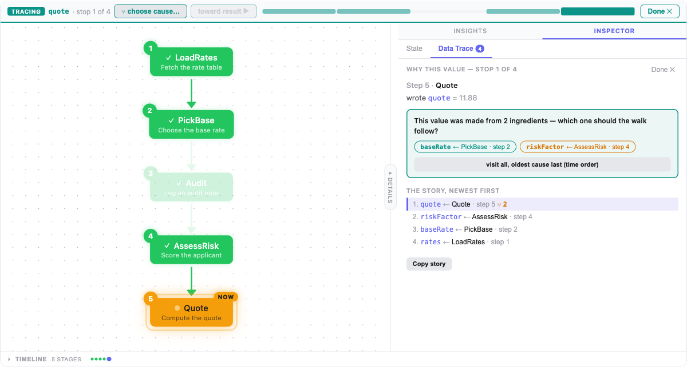

# Flow Lens

<sub>npm package: <a href="https://www.npmjs.com/package/footprint-explainable-ui"><code>footprint-explainable-ui</code></a></sub>

**every step: watch the flowchart unfold**

<p>
  <a href="https://www.npmjs.com/package/footprint-explainable-ui"></a>
  <!-- coverage-badge --><!-- /coverage-badge -->
  <a href="https://github.com/footprintjs/explainable-ui/blob/main/LICENSE"></a>
  <a href="https://footprintjs.github.io/footprint-demo/"></a>
  <a href="https://footprintjs.github.io/footprint-playground/"></a>
</p>

**Flow Lens** is the step-by-step view of a causal trace: themeable React components for
visualizing [footprintjs](https://github.com/footprintjs/footPrint) pipeline execution —
time-travel debugging, flowchart overlays, subflow drill-down, and collapsible detail panels.

> Part of the **[footprintjs ecosystem](https://footprintjs.github.io/)** — the self-explaining stack.
>
> One causal trace. Replay it as every step (**Flow Lens**), grouped steps
> ([**Why Lens**](https://github.com/footprintjs/agentfootprint-lens)), or the story
> ([**Story Lens**](https://github.com/footprintjs/agentThinkingUI)).

## Install

```bash
npm install footprint-explainable-ui
```

**Peer dependencies:** `react >= 18`, `react-dom >= 18`

For flowchart components, also install:

```bash
npm install @xyflow/react
```

## Entry Points

| Import path | What it provides |
|---|---|
| `footprint-explainable-ui` | Core components, themes, adapters |
| `footprint-explainable-ui/flowchart` | Flowchart visualization (requires `@xyflow/react`) |

## Which component do I mount?

Several all-in-one components ship here, and a fifth front door lives one
package over. This is the ladder — take the **first** row your run matches,
and read the last column before you skip one.

| If your run is… | Mount | It gives you | It costs you |
|---|---|---|---|
| an **agentfootprint agent run** you recorded (`recordRun` → `{ snapshot, events, structure }`) | [`footprint-viewer`](https://www.npmjs.com/package/footprint-viewer) — a separate package | The whole experience with zero config: Story, Why, Flow, Skill Graph and Data as five tabs over **one shared cursor**, wired for you — or refused in a sentence that names what you passed | Three more packages (`agentfootprint`, `agentfootprint-lens`, and `agentthinkingui` for the Story tab), and a layout that is the viewer's rather than yours |
| a **footprintjs pipeline run**, live in your app (`executor.getSnapshot()` + a `TraceGraph`) | `ExplainableShell` — this library | Chart + topology tree + inspector + story + timeline + the value-tracing rail, from two props | The agent readings. There is no Story / Why / Skill Graph here: this is the commit-trace lens. (The viewer refuses a bare footprintjs snapshot for exactly that reason — and names this shell as where to go) |
| a **saved footprintjs run** on disk (`{ snapshot, structure }`) | `TraceViewer` | The same shell from one prop, with parse errors and honest gaps stated on screen instead of an empty frame | Nothing the shell has — it *is* the shell plus the file-reading |
| a saved run whose **layout must be yours** | `ExplainableProvider` + the surfaces (or `ExplainableView` with a `layout`) | Every surface as its own component, all moving one cursor; presets, CSS-grid areas, and per-surface `slots` | The shell's richer topology, subflow drill-down and tracing chrome — the surfaces do not re-implement those |
| a run you want to read as **commits and chains** | `TraceExplorerShell` | The L8 translator stack in one master/detail screen: chain tree, commit inspector, node inspector, cursor slider | It is a parts bin rather than a product surface — you create and attach the translators yourself (`createTraceBundle` does that in one call) |

**Not on the ladder:** `TimeTravelDebugger` is deprecated in 0.38.0 — see
[Deprecated](#deprecated).

### Composing panels by hand costs you the wiring

The panels are exported so you *can* build your own screen — but a pane you
mount yourself only has the props you remember to pass. Two capabilities go
quiet when you forget them, and nothing errors:

- **the cursor** — every surface must read *and* move the same index, or your
  chart and your story drift apart on the second click;
- **tracing** — the value-tracing rail is wiring the shell does between the
  inspector, the rail and the chart. A hand-mounted inspector simply has no
  rail to hand back to.

So: inside this library, get the cursor from `ExplainableProvider` (that is
what it is for) rather than passing `selectedIndex` down a tree by hand, and
keep tracing inside `ExplainableShell`, which owns it end to end. And if you
are replacing a pane in `footprint-viewer`, its slots are
**capability-accounted**: a replacement pane is handed every capability the
shipped pane had, and a pane that never uses one gets a named console line in
dev — silenced only by writing the drop down (`slots: { detail: { component:
MyPane, drops: ['tracing'] } }`). Silence there is a decision, not an accident.

## Quick Start

### 1. Capture the chart while it is built

The chart is the one thing a run does not leave behind, so collect it at BUILD
time (or save `chart.buildTimeStructure` — see step 3):

```typescript
import { flowChart, FlowChartExecutor } from "footprintjs";
import { createTraceStructureRecorder } from "footprint-explainable-ui/flowchart";

const trace = createTraceStructureRecorder();
const chart = flowChart("seed", seedFn, "seed", { structureRecorders: [trace.recorder] })
  .addFunction("work", workFn, "work")
  .build();

const executor = new FlowChartExecutor(chart);
await executor.run({ input: data });
```

### 2. Render with the all-in-one shell

```tsx
import { ExplainableShell } from "footprint-explainable-ui";

<ExplainableShell
  runtimeSnapshot={executor.getSnapshot()}
  traceGraph={trace.getGraph()}
  title="My Pipeline"
  panelLabels={{ topology: "What Ran", details: "What Happened", timeline: "How Long" }}
/>;
```

Two props. The shell converts the snapshot into rows, reads the story out of the
recorders that rode along inside it, and lights the executed path from the
commit log. Already have `StageSnapshot[]` from `toVisualizationSnapshots()`?
Pass them as `snapshots` instead.

This gives you:
- **Flowchart** (center) — execution path overlay, click subflow nodes to drill-down
- **Topology panel** (left) — subflow tree navigator, collapsible via VLinePill handle
- **Details panel** (right) — three modes: Insights (the story and any
  recorder views), Inspector (state + data trace), and Result (the run's
  output and console lines). Collapsible.
- **Timeline** (bottom) — Gantt-style stage durations, collapsible
- **Time-travel slider** — scrub through execution steps
- **Breadcrumbs** — navigate back from subflow drill-down
- **Mobile responsive** — auto-stacks vertically below 640px

### Compose the surfaces from external JSON

`ExplainableView` reads the same frozen `{ snapshot, structure, narrativeEntries }`
recording as `TraceViewer`, but its surfaces are independent components sharing
one cursor:

```tsx
import {
  ExplainableProvider,
  TimeTravelBar,
  CompactTimelinePanel,
  TimelinePanel,
  FlowchartPanel,
  ValueInspector,
  CommentaryPanel,
  ExplainableView,
} from "footprint-explainable-ui";

const recording = JSON.parse(savedRunJson);

// Ready-made view
<ExplainableView
  recording={recording}
  layout="product"
  theme={{
    mode: "light",
    tokens: { colors: { primary: "#245c45", warning: "#df6a4e" } },
    flowchart: { done: "#245c45", active: "#df6a4e" },
  }}
/>

// Or own the layout completely. Every component reads and moves the same cursor.
<ExplainableProvider recording={recording}>
  <header><TimeTravelBar /></header>
  <main><FlowchartPanel /></main>
  <section><ValueInspector /></section>
  <section><CommentaryPanel /></section>
  <footer><CompactTimelinePanel /></footer>
</ExplainableProvider>
```

Layout policy stays with the consumer:

| Preset | Surfaces |
| --- | --- |
| `developer` | Original workbench: time controls top, flowchart center, collapsible inspector right, compact timeline bottom |
| `product` | Time controls top, flowchart with collapsible inspector, full-width commentary below; no compact timeline |
| `studio` | Every surface together, including the optional vertical stage rail |
| `linear` | Every surface in one vertical stack |

Pass a named-area definition when a preset is not enough. Omitting a surface
from `areas` hides it; repeating a name spans that surface across cells:

```tsx
<ExplainableView
  recording={recording}
  layout={{
    columns: "320px minmax(0, 1fr)",
    rows: "auto minmax(480px, 1fr) auto",
    areas: [
      ["timeTravel", "timeTravel"],
      ["commentary", "flowchart"],
      ["timeline", "timeline"],
    ],
  }}
/>
```

The `developer` preset is the old workbench geometry rebuilt from these exported
pieces. `ExplainableShell` also remains available for the richer legacy topology,
details, tracing, and subflow features.

The assembled workbench exposes `detailsExpanded`, `defaultDetailsExpanded`,
`onDetailsExpandedChange`, and `detailsLabel` when consumers need to control the
old Details handle themselves.

Use `slots` to replace one surface without rebuilding the workbench:

```tsx
<ExplainableView
  recording={recording}
  slots={{
    commentary: ({ selectedSnapshot }) => (
      <MyCommentary stage={selectedSnapshot} />
    ),
  }}
/>
```

The recording can be an object or a raw JSON string. The provider parses it,
reconstructs the timeline, chart, runtime overlay, state snapshots, and narrative,
then keeps every surface synchronized through a single controlled or uncontrolled
`selectedIndex`. Consumers can inject a built-in mode, fine token overrides,
flowchart state colors, or plain `--fp-*` variables on any ancestor.

### 3. Replaying a recording (no live executor)

**A recording is three things.** Save all three together — miss one and one
surface goes dark:

```ts
const recording = {
  snapshot:  executor.getSnapshot(),     // memory, story, timeline, chart colouring
  structure: chart.buildTimeStructure,   // THE CHART. Nothing else can draw it.
  events:    myEventLog,                 // the agent view (agentfootprint-lens)
};
fs.writeFileSync("run.json", JSON.stringify(recording));
```

`structure` is the piece a run does not leave behind on its own: `getSnapshot()`
never contains it, and no adapter can invent it. Rendering is two props:

```tsx
import { ExplainableShell, graphFromStructure } from "footprint-explainable-ui";

const run = JSON.parse(await fs.readFile("run.json", "utf8"));

<ExplainableShell
  runtimeSnapshot={run.snapshot}
  traceGraph={graphFromStructure(run.structure)}
  traceTheme={{ mode: "light" }}
/>;
```

You do **not** pass a `runtimeOverlay`: the chart's colouring is rebuilt from the
snapshot's own commit log. Pass one only when you have a live
`createTraceRuntimeOverlay` handle. The narrative comes along too — if the run
was recorded with footprintjs's narrative recorder the shell reads the story out
of `snapshot.recorders`, so `narrativeEntries` is only for overriding it.

Runnable, with a generator that records a real run:
[`examples/replay-a-recording/`](./examples/replay-a-recording/) —
`npm run example:record && npm run example:replay`.

Already have the file? `<TraceViewer recording={run} onError={...} />` is the
same composition in one component.

**What a recording honestly cannot show** — each is stated on screen, never
faked: per-stage durations without footprintjs's `metrics()` recorder (the Gantt
shows execution ORDER and says so), error messages (the commit log has no error
channel — a failing stage's writes land, its message does not), and deep subflow
internals (footprintjs keeps those out of the run-level commit log, so a replay
lights the mount stages, not their insides).

### 4. Or compose individual components

```tsx
import {
  TimeTravelControls,
  MemoryInspector,
  ScopeDiff,
  GanttTimeline,
  NarrativeTrace,
} from "footprint-explainable-ui";

function MyDebugger({ snapshots }) {
  const [idx, setIdx] = useState(0);
  const current = snapshots[idx];
  const previous = idx > 0 ? snapshots[idx - 1] : null;

  return (
    <>
      <TimeTravelControls
        snapshots={snapshots}
        selectedIndex={idx}
        onIndexChange={setIdx}
      />
      <MemoryInspector snapshots={snapshots} selectedIndex={idx} />
      <ScopeDiff
        previous={previous?.memory ?? null}
        current={current.memory}
        hideUnchanged
      />
      <NarrativeTrace narrative={snapshots.map(s => s.narrative)} />
      <GanttTimeline snapshots={snapshots} selectedIndex={idx} onSelect={setIdx} />
    </>
  );
}
```

---

## ExplainableShell

The all-in-one orchestrator. Handles time-travel, subflow drill-down, memory/narrative panels, and responsive layout.

### Props

Pass the run one of two ways — `runtimeSnapshot` (the shell converts it) or
pre-converted `snapshots`. Both are optional; pass neither and the shell says
what it wanted instead of rendering empty chrome.

| Prop | Type | Default | Description |
|---|---|---|---|
| `runtimeSnapshot` | `RuntimeSnapshotInput \| null` | — | A recorded `executor.getSnapshot()`. Drives the rows, memory, story, provenance, recorder tabs — and the chart's colouring |
| `snapshots` | `StageSnapshot[]` | — | Pre-converted rows, when you called `toVisualizationSnapshots()` yourself. Wins over `runtimeSnapshot` |
| `traceGraph` | `TraceGraph \| null` | — | The chart. From `createTraceStructureRecorder()` live, or `graphFromStructure(saved.structure)` for a recording. **No chart without it** |
| `runtimeOverlay` | `RuntimeOverlay \| null` | derived from `runtimeSnapshot` | The executed-path colouring. Usually omit — pass one only for a live `createTraceRuntimeOverlay` handle |
| `traceTheme` | `TraceTheme` | — | `{ mode: "light" \| "dark" }` re-themes the whole shell in one word; `visited` / `current` override the two node colours |
| `narrativeEntries` | `NarrativeEntry[]` | read from the snapshot | Structured narrative. Only needed to override the story the recording carries |
| `title` | `string` | `"Flowchart"` | Breadcrumb root label |
| `resultData` | `Record<string, unknown>` | `snapshot.sharedState` | Final output shown on the Result view |
| `logs` | `string[]` | `[]` | Console lines shown under the result |
| `defaultTab` | `ShellTab` | first available | Which details tab opens first |
| `hideTabs` | `string[]` | — | Details tabs to hide by id (e.g. `["result", "memory"]`) |
| `hideConsole` | `boolean` | `false` | Hide the console block on the Result view |
| `recorderViews` | `RecorderView[]` | auto-detected | Extra details tabs. Recorders inside the snapshot already get one each |
| `panelLabels` | `PanelLabels` | `{ topology: "Topology", details: "Details", timeline: "Timeline" }` | Collapsible pill labels |
| `defaultExpanded` | `DefaultExpanded` | `{ details: true }` | Which panels start open |
| `renderFlowchart` | `(props) => ReactNode` | `<TracedFlow>` | Replace the chart renderer. Still requires `traceGraph` |
| `showStageId` | `boolean` | `false` | Print each node's stable `stageId` under its label (teaching aid) |
| `size` | `"compact" \| "default" \| "detailed"` | `"default"` | Size variant |
| `unstyled` | `boolean` | `false` | Strip styles, render `data-fp` attributes |

### Tracing a value — walk the timeline backward through its causes



Open **Inspector → Data Trace** and click one of the "Trace a value" chips.
The time slider stays the same rail — the stages that made that value light
up as **stops**, everything else fades to unlandable ticks, and the buttons
become **◀ earlier cause / toward result ▶**. This works because every
ingredient of a value was always written *earlier in the run* than the value
it fed, so the dependency chain is a sub-sequence of the timeline you already
have. One cursor, no new axis.

- A value made from **two ingredients** shows both as colored chips —
  pressing "earlier cause" visits both (most recent first); nothing is ever
  silently skipped. Click a chip to **follow** just that ingredient (the
  breadcrumb shows `key ▸ via ingredient · show all`).
- Every stop shows the world **as it was at that moment** — the state panel
  time-travels with the walk for free.
- **Honest absence**: a value nobody wrote gets a truthful card ("no recorded write; value unknown"), and a value not
  written *yet* at the cursor's moment says exactly that, naming where its
  first write happens. Reads-off runs say "unknowable, not absent".
- **[Copy story]** uses `formatTraceWalk`. A tool using the same selected record, scope and
  step numbering receives the identical text; arbitrary external tools need
  not use that formatter. Root mount labels are derived from the recorded tree.
- **Trace inside a subflow**: drill into a recorded child, then open
  Inspector → Data Trace. Search, ingredient follow, earlier cause and Done
  use that child's own history. Repeated visits are identified by runtime ID;
  the breadcrumb names the selected visit, and an ambiguous click offers a
  visit choice. Story shows only that visit's recorded entries.
  Recorded child results must be keyed by the exact mount runtime ID; a
  path-only alias is not proof of a visit, even if a partial record shows just
  one. Custom snapshot hosts can provide the exact result map or attach the
  matching result to the selected `StageSnapshot`.
- Values already present when a child starts may come from input mapping or
  state restored after a pause. Cards and copied stories check the selected
  invocation's own starting data for each key. A recorded non-undefined
  starting value says "recorded at invocation start; earlier origin unknown";
  a key absent there says "no recorded write; value unknown". These records
  cannot reliably distinguish input mapping from restored state, so neither
  origin is asserted. Missing evidence stays unknown.
- Refreshing the same run keeps the selected visit and trace question. A new
  run keeps the root cursor; if a selected child visit is absent, the viewer
  returns to the nearest available level and explains why. Navigation clears
  that notice and any visit chooser.
- Supply each run's own Story, state and overlay when overriding the recorded
  data. Known old inputs are withheld; null inputs and explicit empty arrays
  remain valid choices.
- Agent tools can use the same public `projectTraceInvocation`,
  `buildTraceWalk` and `formatTraceWalk` functions as the viewer. See
  [the tracing guide](https://github.com/footprintjs/explainable-ui/blob/main/src/components/ExplainableShell/_internal/README.md)
  for the scope example, evidence limits and offline package checks.
- **Trace anything**: below the current step's chips, a search box lists
  *every* variable the run ever wrote — trace any of them from wherever you
  stand.
- **Forks ask, never assume**: at a value made from two or more ingredients
  the walk-back button becomes **⑂ choose cause…** and asks which ingredient
  to follow (or "visit all, in time order"). Nothing is ever silently picked.



- **Unmistakable mode**: the whole tracing rail wears its own color
  (`--fp-tracing`, teal by default — themeable) so tracing can never be
  confused with normal time-travel.

### Panel Labels

Customize the text on collapsible pill buttons. Semantic keys — not tied to position:

```tsx
<ExplainableShell
  panelLabels={{
    topology: "What Ran",      // left panel (subflow tree)
    details: "What Happened",  // right panel (memory/narrative)
    timeline: "How Long",      // bottom panel (Gantt)
  }}
/>
```

### Default Expanded

Control which panels start open. Desktop default: details panel open (flowchart + memory = the library's unique value). For mobile, pass all `false`:

```tsx
// Desktop (default) — memory panel open
<ExplainableShell snapshots={...} traceGraph={...} runtimeOverlay={...} />

// Mobile — all collapsed, flowchart fills screen
<ExplainableShell
  snapshots={...}
  defaultExpanded={{ details: false }}
/>

// Everything open
<ExplainableShell
  snapshots={...}
  defaultExpanded={{ topology: true, details: true, timeline: true }}
/>
```

### Responsive Layout

The shell auto-detects container width via `ResizeObserver`:

- **Desktop (≥640px):** 3-column layout — SubflowTree | Flowchart | Memory/Narrative. Side panels collapse to VLinePill handles.
- **Mobile (<640px):** Stacked vertical — Flowchart (350px) → collapsible HLinePill sections. All panels auto-collapse on narrow.

### Collapsible Panel UX

All panels use the **line + pill** pattern:
- **Collapsed:** Thin divider line with a centered pill button (label + arrow)
- **Expanded:** Full content with a pill handle on the closing edge
- **VLinePill** (left/right panels): Vertical line with centered vertical pill. `side` prop controls arrow direction.
- **HLinePill** (bottom timeline): Horizontal line with centered pill.

---

## Flowchart Visualization

Import from `footprint-explainable-ui/flowchart`. The chart is recorder-driven:
a `TraceGraph` says what the chart IS, a `RuntimeOverlay` says what ran.

### TracedFlow — the chart plus the run

```tsx
import { TracedFlow } from "footprint-explainable-ui/flowchart";

<div style={{ height: 400 }}>
  <TracedFlow
    graph={trace.getGraph()}       // from createTraceStructureRecorder
    overlay={overlayFromSnapshot(snapshot, { narrativeEntries })}  // or a live createTraceRuntimeOverlay
    scrubIndex={idx}
    theme="light"
    onNodeClick={(stageId) => handleClick(stageId)}
  />
</div>
```

Without an `overlay` it renders the plain build-time chart. With one, the
executed path lights up, un-run stages fade, and each executed node carries its
step number. Subflow mount nodes drill on click, and the chart re-fits itself
whenever its container resizes.

Both `TraceFlow` and `TracedFlow` wait for a visible, non-zero chart pane and
finite measurements for every visible node before fitting. Hidden or not-yet-
measured charts wait for a real measurement or resize notification, rather than
guessing readiness after a fixed number of frames. Automatic fits are immediate;
they do not start a zoom animation that could outlive the visible container.
Ordinary replay, selection and overlay updates preserve the user's pan and zoom.
Manual viewport controls remain available.

#### A stage that had to be tried again says so on the chart

When footprintjs (≥ 9.15.0) retries a stage under a declared `retry` policy,
that node wears a small amber `↺ ×3` chip — "this took three attempts" —
alongside whatever status it ended in. A stage that recovered stays green with
the chip; a stage that exhausted its policy stays red with the chip. A screen
reader hears the whole fact: *"retried, attempt 3 of 3 succeeded"*.

Three things it deliberately will not do:

- **It never adds a step.** All attempts share one `runtimeStageId` and one
  commit bundle, so a retried stage is still exactly one stop on your rail.
- **It never shows for a policy that was only declared.** Declared is not the
  same as happened; a stage that carries `.retry({ attempts: 2 })` and sails
  through is unmarked.
- **It never appears at `×1`.** One attempt is the silent default.

The chart reads this from the overlay, so it works live and on replay. Live
comes free (`createTraceRuntimeOverlay` now listens to `onStageRetry`). On
replay, a failed attempt discards its writes, so the commit log genuinely
cannot know — `overlayFromSnapshot` reads the count the engine stamped on the
stage's execution-tree node instead (`attemptSummary`, footprintjs ≥ 10.1),
so a whole `executor.getSnapshot()` is enough. A recording from footprintjs
9.15–10.0 has no summary; pass its narrative, whose `retry` entries carry the
same count:

```tsx
overlay={overlayFromSnapshot(recording.snapshot, {
  narrativeEntries: recording.narrativeEntries,   // only for 9.15–10.0 recordings
})}
```

`<ExplainableShell>`, `<ExplainableView>` and `<TraceViewer>` already pass it
for you.

### Where the graph comes from

| You have | Call | Notes |
|---|---|---|
| a live build | `createTraceStructureRecorder()` → `flowChart(..., { structureRecorders: [rec] })` | collects the chart AS it is built |
| a saved run | `graphFromStructure(saved.structure)` | `saved.structure` is `chart.buildTimeStructure` |

Both produce the same `TraceGraph`, with the same node ids — which is what lets
either overlay light the right boxes.

---

## Theming

**Every default in this library is dark.** Dropped into a light app with nothing
set, a panel renders dark — correct by the rules, wrong on the page. There are
three ways to fix that, smallest first.

### 1. One word, per component

```tsx
<ExplainableShell traceTheme={{ mode: "light" }} />   {/* the shell */}
<TraceViewer theme="light" />                          {/* the standalone components */}
<SnapshotPanel theme="light" />
<GanttTimeline theme="light" />
<TracedFlow theme="light" />
```

`theme` stamps a full built-in preset as `--fp-*` variables on that component's
own root, so everything under it follows. It is the whole theme wiring for an
app that just wants light.

### 2. Follow the app's own dark mode — `useDarkModeTokens`

The direct answer to "why is your UI dark inside my light app". The hook watches
your app's dark-mode switch and hands back the matching preset:

```tsx
import { FootprintTheme, useDarkModeTokens } from "footprint-explainable-ui";

function MyApp() {
  const tokens = useDarkModeTokens();              // Tailwind's `.dark` on <html>
  return (
    <FootprintTheme tokens={tokens}>
      <ExplainableShell runtimeSnapshot={snapshot} traceGraph={graph} />
    </FootprintTheme>
  );
}
```

Whatever switch your app uses, name it:

```tsx
useDarkModeTokens({ darkClass: "theme-dark" })            // a class name
useDarkModeTokens({ darkClass: '[data-theme="dark"]' })   // any CSS selector
useDarkModeTokens({ light: warmLight, dark: warmDark })   // your own palettes
```

It re-themes live when the switch flips, and it is server-safe: on the server
there is no `document`, so the first render is light and the client corrects on
mount.

### 3. CSS variables (full control)

Consumer controls theme via `--fp-*` CSS custom properties. Components use `var(--fp-*, fallback)`:

```css
:root {
  --fp-color-primary: #7c6cf0;
  --fp-accent: #7c6cf0;             /* active tab / selected rule */
  --fp-accent-bg: rgba(124,108,240,0.14); /* wash behind a selected row */
  --fp-bg: #1e1a2e;                 /* panel body surface */
  --fp-bg-elevated: #2a2540;        /* raised cards on that surface */
  --fp-bg-primary: #1e1a2e;
  --fp-bg-secondary: #2a2540;
  --fp-bg-tertiary: #3a3455;
  --fp-text-primary: #f0e6d6;
  --fp-text-secondary: #b0a898;
  --fp-text-muted: #6b6b80;
  --fp-border: #3a3455;
  --fp-tracing: #3ecfb2;            /* the "walking a value's causes" rail */
  --fp-chip-1: #0d9488;             /* the four ingredient-chip hues (categorical) */
  --fp-chip-2: #d97706;
  --fp-chip-3: #7c3aed;
  --fp-chip-4: #e11d48;
  --fp-radius: 8px;
  --fp-font-sans: 'Inter', system-ui, sans-serif;
  --fp-font-mono: 'JetBrains Mono', monospace;
}
```

Every built-in preset sets all of these, so one `mode` re-themes the whole shell
— no component is left on a hard-coded dark default. `test/unit/themeTokens.test.ts`
enforces both halves of that: every `--fp-*` a component reads must be emitted by
every preset, and no component may paint a raw colour the theme cannot reach.

### ThemeProvider

```tsx
import { FootprintTheme, warmDark } from "footprint-explainable-ui";

<FootprintTheme tokens={warmDark}>
  <MyApp />
</FootprintTheme>
```

### Built-in Presets

| Preset | Description |
|---|---|
| `coolDark` | Default — indigo/slate dark theme |
| `warmDark` | Charcoal-purple with warm text |
| `warmLight` | Cream/peach light theme |
| `coolLight` | Light indigo theme |

---

## Components Reference

### Core Components

| Component | Description |
|---|---|
| `ExplainableShell` | All-in-one orchestrator with collapsible panels and responsive layout |
| `TimeTravelControls` | Play/pause, prev/next, scrubber timeline |
| `MemoryPanel` | Memory state + scope diff (composite right-panel view) |
| `NarrativePanel` | Narrative trace with progressive reveal |
| `StoryNarrative` | Rich rendering of structured `NarrativeEntry[]` |
| `NarrativeTrace` | Collapsible stage groups with progressive reveal |
| `NarrativeLog` | Simple timeline-style execution log |
| `ScopeDiff` | Side-by-side scope changes (added/changed/removed) |
| `ResultPanel` | Final pipeline output + console logs |
| `MemoryInspector` | Accumulated memory state viewer |
| `GanttTimeline` | Horizontal duration timeline (collapsible) |
| `SnapshotPanel` | All-in-one inspector (scrubber + memory + narrative + Gantt) |
| `TraceViewer` | Renders a saved `{ snapshot, structure }` recording — parse, diagnose, draw |
| `StageDetailPanel` | One stage in full: its reads, its writes, its description |
| `InspectorPanel` | The Inspector: State tab + Data Trace tab, time-travel synced |
| `DataTracePanel` | The backward causal chain as a stack trace — click a frame to go there |
| `TraceWalkCard` | The "why this value" stop card for the tracing rail (ingredient chips, itinerary, Copy story) |
| `InvestigationPanel` | Host-bound, on-demand recorded cause and impact results with unknown evidence states |
| `GroupedFlowInvestigation` | Grouped run diagram with on-demand recorded cause, backward relationships and impact |
| `InsightPanel` | Recorder outputs as tabs or a grid — Story, Performance, Quality, Cost |
| `CompactTimeline` | Collapsed = a row of dots, expanded = the Gantt. The shell's footer |

### Composable surfaces (`ExplainableView`)

One frozen recording, one cursor, independent surfaces. Every surface below
reads and moves the same index — that is what the provider is for.

| Export | Description |
|---|---|
| `ExplainableProvider` | Parses the recording once and holds the ONE cursor every surface shares |
| `useExplainableRun` | Read that cursor (and the parsed run) from your own component |
| `ExplainableView` | The assembled workbench — a preset, a grid of `areas`, or `slots` |
| `TimeTravelBar` | Transport controls: play/pause, prev/next, the scrubber |
| `TimelinePanel` | The vertical stage rail |
| `FlowchartPanel` | The chart surface, already wired to the cursor |
| `ValueInspector` | State + changes at the cursor's moment |
| `CommentaryPanel` | The story, revealed up to the cursor |
| `CompactTimelinePanel` | The provider-wired `CompactTimeline` — no data props |
| `SurfaceCollapseHandle` | The line + pill handle, for collapsing a surface of your own |

`CompactTimeline` and `CompactTimelinePanel` are not duplicates and neither is
going away: the first is the **controlled primitive** (you pass `snapshots` and
`selectedIndex`, so it works anywhere — it is what `ExplainableShell` puts in
its footer); the second is the **provider-wired surface** that renders it and
takes no data props at all. Inside a provider use the Panel; outside one, only
the primitive can work.

### Theme API

| Export | Description |
|---|---|
| `FootprintTheme` | Provider that stamps a token set on everything below it |
| `useFootprintTheme` | Read the tokens the nearest provider set |
| `useDarkModeTokens` | Follow your app's OWN dark-mode switch (class or selector) and hand back the matching preset |
| `themeModeVars` | The `--fp-*` variables for one mode, ready to spread onto your own wrapper |
| `tokensToCSSVars` | Turn a token object into that variable map yourself |
| `defaultTokens` | The shipped default token set (dark) |
| `rawDefaults` | The same defaults as plain values, with no `var()` indirection |
| `themePresets` | All four built-in presets, by name |

### Utilities

| Export | Description |
|---|---|
| `buildEntryRangeIndex` | Index narrative entries by `runtimeStageId` for O(1) slider sync |
| `computeRevealedEntryCount` | How many story lines are true as of the cursor's step |
| `extractSubflowNarrative` | Just one subflow's lines out of a run's story |
| `buildTraceWalk` | The value-tracing walk (stops + ingredients) for one key |
| `formatTraceWalk` | That walk as the exact text an LLM backtrack tool returns |
| `projectTraceInvocation` | Select one exact recorded child invocation and its scope for UI or agent trace text |
| `mergeWritePatch` | Replay a commit patch onto a state object (objects merge; arrays REPLACE) |
| `DEFAULT_EXCLUDED_KEYS` | The keys `StageDetailPanel` hides by default |

### Flowchart Components (`footprint-explainable-ui/flowchart`)

This entry has a wider surface than the four names most people use, so here
is all of it — grouped by the job, one line each. Nothing below is
experimental; the ones you will actually reach for are in the first table.

**Draw the chart**

| Export | Description |
|---|---|
| `TracedFlow` | The chart plus the run — overlay colouring, drill-down, breadcrumb, auto-fitView |
| `TraceFlow` | Build-time chart only (no overlay) |
| `StageNode` | The node renderer: state-aware colouring, step badges, retry-attempt chip, pulse rings |
| `SubflowTree` | Tree view of all subflows (the shell's left panel) |
| `NodeInspector` | What one node is and where it sits, from a `NodeView` index |
| `CommitInspector` | What one commit wrote, and what it read to write it |
| `CommitChainView` | The run as a git-log-style swim lane of commit chains |
| `TraceExplorerShell` | The whole L8 stack composed: chain tree + inspectors + slider |
| `RunSlider` | The one-cursor time-travel slider |
| `LoopBackEdge` | The curved `loopTo` back-edge. Built in — export is for consumers who replace `edgeTypes` wholesale |
| `SmartStepEdge` | The rank-skipping edge that routes around skipped nodes. Also built in |

**Feed the chart**

| Export | Description |
|---|---|
| `createTraceStructureRecorder` | Collect the `TraceGraph` while footprintjs builds the chart |
| `graphFromStructure` | The same graph from a SAVED `chart.buildTimeStructure` |
| `createTraceRuntimeOverlay` | Collect the `RuntimeOverlay` from a live run |
| `overlayFromSnapshot` | The same overlay from a recorded snapshot |
| `createTraceBundle` | All four translators + one `attachTo(executor)` call |
| `useTranslator` | Subscribe a React component to any translator's snapshot |

**Change what the chart shows**

| Export | Description |
|---|---|
| `filterGraphForDrill` | Narrow a graph to one subflow's insides — keyed by the MOUNT NODE'S id |
| `buildSubflowBreadcrumb` | The trail back out of that drill |
| `collapseTraceGraph` | Hide caller-chosen nodes; edges contract through them, and you get back what was hidden |
| `sliceOverlay` | The overlay as of step N: done / active / executed / retry counts |

**Layout**

| Export | Description |
|---|---|
| `dagreTraceLayout` | The default structure-derived layout |
| `createDagreTraceLayout` | The same, with your options |
| `defaultTraceFlowLayout` | The layout `TraceFlow` uses when you pass none |
| `snapLinearSuccessors` | Post-dagre pass: snap linear successors onto their predecessor's centre-x |
| `createSnappedDagreLayout` | Dagre + that snap pass, composed |
| `traceGroupLayout` | Rank bands + span-centred merges, for staggered structured charts |
| `createTraceGroupLayout` | The same, with your options |
| `applyGroupLayout` | Nest a graph's nodes inside subflow group containers |
| `createGroupedLayout` | A layout that applies grouping over any base layout |
| `wrapInMainChartBox` | Wrap the whole chart in one titled container box |
| `createMainChartBoxLayout` | A layout that does that wrapping |
| `GroupContainerNode` | The container node type those layouts emit |
| `SlotPillNode` | The pill node used for a group's slots |
| `GROUP_CONTAINER_NODE_TYPE` | Its node-type key, for a custom `nodeTypes` map |
| `MAIN_CHART_BOX_ID` | The id of the wrapper box, so you can find or skip it |

**Read the run as data (translators + walks)**

| Export | Description |
|---|---|
| `createNodeViewRecorder` | Per-stage summary index (what ran, in what order, with what) |
| `createCommitFlowRecorder` | Per-commit summary index + data lineage |
| `walkForward` / `walkBackward` | BFS over the structure from one node, either direction |
| `backtraceStructural` / `forwardtraceStructural` | The same two walks, named for what they answer |
| `backtraceDataFlow` | Which commits fed this commit — lineage, not topology |
| `structureAsChainTree` | The chart as series/parallel chains (no run needed) |
| `buildCommitChainTree` | The same chains, filled in with what actually committed |

### Adapters

| Export | Description |
|---|---|
| `toVisualizationSnapshots` | Convert `FlowChartExecutor.getSnapshot()` → `StageSnapshot[]` |
| `graphFromStructure` | Rebuild the chart's `TraceGraph` from a saved `chart.buildTimeStructure` — the post-hoc twin of `createTraceStructureRecorder` |
| `overlayFromSnapshot` | Rebuild the chart's `RuntimeOverlay` from a recorded snapshot (replay without a live executor). Retry attempts come from the snapshot's tree (footprintjs ≥ 10.1); for a 9.15–10.0 recording pass `{ narrativeEntries }` |
| `narrativeFromSnapshot` | Read the narrative a recorded snapshot carries in `snapshot.recorders` |
| `subflowResultToSnapshots` | Convert subflow result → `StageSnapshot[]` |
| `createSnapshots` | Build `StageSnapshot[]` from simple arrays (testing/custom data) |

### Types

| Export | Description |
|---|---|
| `PanelLabels` | `{ topology?, details?, timeline? }` — pill label customization |
| `DefaultExpanded` | `{ topology?, details?, timeline? }` — initial panel state |
| `StageSnapshot` | Core snapshot type for all components |
| `NarrativeEntry` | Structured narrative entry with type/depth/stageName |
| `Recording` | `{ snapshot, structure, events }` — one saved run, read by `<TraceViewer>` and by lens's `observeRecording` |
| `ThemeMode` | `"dark" \| "light"` — the one-word switch |

### Deprecated

Still exported, still working, still tested — and going away in the next
major. Each row says what to use instead; each one also prints the same
sentence to the console once, in dev, the first time it renders.

| Deprecated in 0.38.0 | Why | Use instead |
|---|---|---|
| `TimeTravelDebugger` | It owns its cursor — the scrubber index is local state with no `selectedIndex` / `onIndexChange`, so nothing outside it can move the time position or read it. That is why no shipped surface in this library uses it, and it is why it overlaps `SnapshotPanel` feature for feature without being composable | `SnapshotPanel` (the same panels, controlled), `ExplainableShell` (those plus the chart), or `footprint-viewer` |
| `useSubflowNavigation` | It keys the drill by the child chart's LOCAL `subflowId`, which is **not unique** — mount the same chart twice and both mounts report the same key, so a filter keyed on it shows the other mount's stages, or nothing. Its `currentGraph` also never swaps to the child's graph, so the chart never actually narrows | `TracedFlow`'s built-in drill (`currentSubflowId` + `onSubflowChange`, keyed by the mount NODE'S id), or `filterGraphForDrill` directly |
| `SubflowBreadcrumb` | The display half of that same pair — it renders a `useSubflowNavigation` stack and nothing else produces one | `TracedFlow` (it draws its own trail), or `buildSubflowBreadcrumb(graph, mountNodeId)` |

### Narrative entry kinds

Every `NarrativeEntry` carries a `type`. `<StoryNarrative>` gives each one its
own badge — the icon you see, and the label a screen reader hears:

| `type` | Badge | Label | What it means |
|---|:---:|---|---|
| `stage` | ▸ | Stage | A stage ran. Gets a heading number. |
| `step` | · | Data operation | One read or write inside a stage. |
| `condition` | ◇ | Decision | A decider chose a branch. |
| `fork` | ⑃ | Parallel | A fan-out started. |
| `selector` | ⑃ | Selector | A selector chose which branches run. |
| `subflow` | ↳ | Subflow | Entering or leaving a mounted subflow. |
| `loop` | ↻ | Loop | A `loopTo` back-edge was taken. |
| `break` | ■ | Break | `$break()` ended the loop. |
| `error` | ✗ | Error | The stage failed. |
| `pause` | ‖ | Paused | The run stopped and is waiting on someone. |
| `resume` | ▷ | Resumed | It carried on from the checkpoint. |
| `emit` | ◈ | Emitted event | Your own `scope.$emit` telemetry. |
| `retry` | ↺ | Retry | One attempt failed and the stage is running again (footprintjs 9.15–10.0). |
| `attempt` | ↺ | Attempt | One attempt of a retried stage: how it ended, how long it took, and whether the stage tries again (footprintjs ≥ 10.1). |

Two kinds are worth reading twice. **`retry`** (footprintjs 9.15–10.0) is
*attempt* telemetry, not an outcome — the entry's text carries the arithmetic
("attempt 2 of 3 at FetchQuote failed"), it nests inside its own stage, and the
stage may still succeed, so it is warning-weight rather than error-weight. All
attempts share ONE step on the time-travel rail, so a retried stage never
multiplies your cursor — and the flowchart says the same thing with the same
arrow (see the attempt chip above), so the two surfaces never disagree.
**`loop`** and **`retry`** deliberately use different arrows: ↻ is a by-design
back-edge, ↺ is a failure going round again. footprintjs 10.1 replaces the
`retry` line with one **`attempt`** line per attempt, styled the same way.

A kind from a newer footprintjs than this release knows about still compiles
and still renders. `NarrativeEntry['type']` accepts any string, so handing
`executor.getNarrativeEntries()` to a component here never breaks your build
when the engine gains a kind. The entry gets a plain `◦` badge labelled
"Narrative entry" and its text as the engine wrote it.

In `unstyled` mode each entry also carries `data-type="<kind>"`, so you can
style any kind — including a future one — by selector:

```css
[data-fp="narrative-entry"][data-type="retry"] { color: #b45309; }
```

---

## Recipes

One runnable snippet per part that the reference tables above name but no
section shows. Each is the smallest honest use.

**`collapseTraceGraph` — hide nodes, and say how many**

```tsx
import { collapseTraceGraph, TracedFlow } from "footprint-explainable-ui/flowchart";

// The predicate is YOURS — this library special-cases no id convention.
const { graph, hiddenNodeIds } = collapseTraceGraph(
  trace.getGraph(),
  (node) => node.id.startsWith("sf-internal/"),
);

<TracedFlow graph={graph} overlay={overlay} />;
<p>{hiddenNodeIds.length} steps hidden</p>;
```

**`filterGraphForDrill` — show one subflow's insides**

```tsx
import { filterGraphForDrill, buildSubflowBreadcrumb, TraceFlow } from "footprint-explainable-ui/flowchart";

const mountId = "pipeline/prepare";                       // the MOUNT NODE'S id
const inside = filterGraphForDrill(graph, mountId);       // null = top level
const trail = buildSubflowBreadcrumb(graph, mountId);

<TraceFlow graph={inside} />;
<nav>{trail.map((crumb) => crumb.label).join(" › ")}</nav>;
```

**`sliceOverlay` — what had run by step N**

```ts
import { sliceOverlay } from "footprint-explainable-ui/flowchart";

const at = sliceOverlay(overlay, 3);   // the same slice <TracedFlow scrubIndex={3}> paints
at.activeStageId;    // "process" — the stage the cursor sits on
at.doneStageIds;     // Set { "seed", "validate" }
at.retryAttempts;    // Map { "fetch" => 3 } — only stages that needed more than one attempt
```

**The narrative-sync trio — reveal the story as the cursor moves**

```ts
import {
  buildEntryRangeIndex, computeRevealedEntryCount, extractSubflowNarrative,
} from "footprint-explainable-ui";

const index = buildEntryRangeIndex(entries);                          // once per run
const shown = computeRevealedEntryCount(entries, snapshots, idx, index);
const storySoFar = entries.slice(0, shown);                           // true as of step `idx`
const justPricing = extractSubflowNarrative(entries, "sf-pricing");   // one subflow's lines
```

**`themeModeVars` — put the built-in palette on your own wrapper**

```tsx
import { themeModeVars, MemoryInspector } from "footprint-explainable-ui";

// Same variables `theme="light"` stamps — but on an element you own,
// so everything underneath (yours included) follows it.
<div style={{ ...themeModeVars("light"), padding: 16 }}>
  <MemoryInspector snapshots={snapshots} selectedIndex={idx} />
</div>;
```

**`mergeWritePatch` — replay a commit patch onto state you already have**

```ts
import { mergeWritePatch } from "footprint-explainable-ui";

mergeWritePatch({ user: { id: 1, name: "Ada" } }, { user: { name: "Grace" } });
// → { user: { id: 1, name: "Grace" } }   objects merge per key

mergeWritePatch({ tags: ["a", "b"] }, { tags: ["c"] });
// → { tags: ["c"] }                      arrays REPLACE, deliberately
```

## Size Variants

All components accept a `size` prop: `"compact"`, `"default"`, or `"detailed"`.

```tsx
<GanttTimeline snapshots={snapshots} size="compact" />
<MemoryInspector snapshots={snapshots} size="detailed" />
```

## Unstyled Mode

Strip all built-in styles for full CSS control. Components render semantic `data-fp` attributes:

```tsx
<NarrativeTrace narrative={lines} unstyled className="my-narrative" />
```

```css
[data-fp="narrative-header"] { font-weight: bold; }
[data-fp="narrative-step"] { padding-left: 2rem; }
```

---

## Golden-Trace Fixtures (contributors)

The pipeline (structure/runtime translators, dagre layout, snapshot adapter,
narrative sync) is pinned against **real footprintjs engine output**, not
hand-built mocks. `test/fixtures/golden/` holds recorded traces from 5
representative charts (linear+decider, subflow+loop, parallel fork,
pause/resume, retry attempts); `test/golden/goldenTraces.test.ts` replays them through the full
pipeline and snapshot-asserts the outputs in `test/golden/__snapshots__/`.

- **Engine shape changed** (new footprintjs): `npm i -D --save-exact footprintjs@<version> && npm run fixtures:regen`. The generator runs every chart twice and fails on any nondeterminism.
- **Pipeline output changed intentionally** (eui edit): `npx vitest run test/golden -u`, then review the snapshot diff.
- `test/fixtures/golden/manifest.json` records the footprintjs version the fixtures were recorded with.

`footprintjs` is a devDependency used ONLY by the generator — the published
library still has zero footprintjs dependency (it consumes plain JSON shapes).

## On-demand investigation

`InvestigationPanel` is a standalone, optional panel. Existing viewers and their
selected visits do not change. The host supplies a bounded canonical attention
list and handles each explicit investigation with Foottrace's `explain` API.
No query runs on mount. Recorded paths, alternatives, affected items and evidence
references start collapsed; selecting a related item requests only that item.
An explicit investigation moves keyboard focus into the selected explanation.
Closing it restores focus to the original attention item, including after
following related items or opening an item beyond the first attention page.

```tsx
import { useMemo } from "react";
import { InvestigationPanel, type InvestigationPort } from "footprint-explainable-ui";
import { explain } from "foottrace/cause";

function RunInvestigation({ session }) {
  // session is a trusted host object for ONE tenant/run/source and exact
  // invocation, attempt and visit. Replace it when any of these changes.
  const port = useMemo<InvestigationPort>(() => ({
    binding: session,
    attention: session.attention,
    labels: session.labels, // include exact visit/attempt labels when relevant
    explain: (nodeId, { signal }) => explain(session.graph, nodeId, {
      signal, maxNodes: 128, maxEdges: 256, maxCalls: 512, timeoutMs: 2_000,
    }),
  }), [session]);
  return <InvestigationPanel port={port} />;
}
```

The host binds authorization, tenant, run, storage, exact selected scope and
query/storage budgets before creating the port. A request contains only the
opaque canonical `NodeId` already supplied by that host, plus cancellation.
Create a new `binding` identity whenever the bound evidence or selected
invocation, attempt, visit or run changes. Ordinary rerenders and callback
replacements with the same binding preserve the open query. Source mutation in
place is unsupported: replace the binding when evidence changes. Late results
from a previous binding or closed panel are ignored even if the host ignores
cancellation. `port={null}` explicitly presents an unavailable investigation.

The panel displays Foottrace's selected root and alternatives; it does not walk,
rank or discover a graph. A supported root can coexist with incomplete forward
impact evidence. Missing evidence, not-collected outcomes, unlisted effects and
unsupported results stay unknown. The canonical-derived `InvestigationResult`
omits unused impact edges, so new edge attribution metadata can pass through a
host without translation. Unknown future gap codes are refused explicitly.

Display admission checks only the fields it uses: each node list has at most
256 entries, each item at most 16 attention marks, each gap list at most 128
entries, each evidence list at most 32 references, free-form projected
strings at most 2,048 code units each and 65,536 combined per result. Fixed enum
text is separately bounded by its closed vocabulary and the list limits. Names are plain
escaped text, capped at 512 code units; IDs remain the selection identity.
Unsupported, mismatched, oversized, sparse or accessor-backed projected fields
produce a fixed unavailable message. Unused graph metadata is neither inspected
nor displayed. This is display admission, not authentication or a JavaScript
sandbox. The host still enforces storage admission and actual query work limits.

No storage adapter ships in this panel. Supplying an already loaded archive does
not establish storage-I/O laziness; per-scope receipt and ownership admission is
required before a future indexed loader can expose a scope. Foottrace remains
the owner of graph traversal and source interpretation.

## The footprintjs ecosystem

The self-explaining stack — from backend pipelines to AI agents. → **[overview](https://footprintjs.github.io/)**

| Project | Role |
|---|---|
| [footprintjs](https://footprintjs.github.io/footPrint/) | the flowchart pattern (core engine) |
| [agentfootprint](https://footprintjs.github.io/agentfootprint/) | build self-explaining AI agents |
| **Explainable UI** ← you are here | visualize a footprintjs run |
| [Lens](https://github.com/footprintjs/agentfootprint-lens) | debug an agentfootprint run |
| [Thinking UI](https://footprintjs.github.io/agentThinkingUI/) | replay an agent run for non-devs |

---

## License

MIT

## Grouped flow diagrams (unreleased)

`GroupedFlowDiagram` is an optional, data-first view for an owner who wants to open a flow card, inspect its steps, and follow a recorded problem. It reuses the package's group frame, ReactFlow canvas and existing Dagre dependency. Group projection and layout live in one pure module; this does not add another execution engine, storage reader or cause-finding algorithm.

```tsx
import { GroupedFlowDiagram } from 'footprint-explainable-ui/flowchart';
import '@xyflow/react/dist/style.css';

const definition = {
  nodes: [
    { id: 'payment-instance-1', label: 'Payment', kind: 'group', icon: 'card' },
    { id: 'authorize-visit-1', label: 'Authorize card', parentId: 'payment-instance-1' },
    { id: 'capture-visit-1', label: 'Capture payment', parentId: 'payment-instance-1' },
  ],
  edges: [{ id: 'authorize-capture', source: 'authorize-visit-1', target: 'capture-visit-1' }],
} as const;

<GroupedFlowDiagram
  definition={definition}
  // These are example facts supplied by an admitted recording, not display settings.
  observation={{ nodeStates: { 'authorize-visit-1': 'completed' } }}
  defaultExpandedGroupIds={['payment-instance-1']}
  onSelectNode={nodeId => inspectThatExactRecordedItem(nodeId)}
/>;
```

The same component and types are exported from the root entry. The runnable [grouped-flow example](examples/grouped-flow/README.md) includes configuration, explicit synthetic observations, branch labels and a fixed recorded-path highlight. `/nested.html` demonstrates two instances of Payment and repeated Validate names.

### Structure, facts and emphasis

- `definition` contains app-approved plain labels, descriptions, icon hints, group-instance `parentId` values and possible transitions. It must describe the same definition/version as the recording. IDs identify the exact instance/visit, not a reusable flow's name. Rendered Group/Item captions disambiguate repeated names; their numbers are reading aids, not execution order.
- `observation.nodeStates` accepts `unknown`, `running`, `completed`, `failed` and `not-run`. `edgeStates` accepts `unknown`, `observed` and `not-taken`. An omitted state stays unknown. Only an explicit recorded state produces a completed badge or a not-run label. A completed step says nothing about external settlement or delivery without the host's appropriate receipts.
- A group does **not** become completed because its children completed. It can show recorded issues inside while its own outcome remains unknown. Contradictory observations, such as an observed edge touching a not-run step, are refused.
- `highlight` contains exact node/edge IDs supplied by the host. For cause and impact, use the existing canonical Foottrace result through the host's investigation adapter. Emphasis never walks design predecessors or asserts a root cause. A collapsed group can carry the emphasis of a hidden member; projected edges retain the original edge ID and do not create new relationships.

### Expansion and interaction

Use `defaultExpandedGroupIds` for local expansion state, or `expandedGroupIds` plus `onExpandedGroupIdsChange` for controlled expansion. With controlled IDs and no change callback, expansion controls are read-only. `selectedNodeId` and `onSelectNode` similarly support host-bound selection; `null` clears controlled selection. Callback IDs always identify the original item, never its label or a collapsed proxy.

**Reveal selection** opens known ancestor groups and frames the selected item. **Focus highlighted path** frames host-emphasized visible items and the visible endpoints of emphasized connections, without changing their evidence or state; **Fit diagram** restores an overview. Narrow canvases initially frame a visible selected item for readability. Camera changes have zero duration. Equivalent same-record rerenders preserve expansion and the camera. Hosts should key the component by the exact run/binding when replacing a recording, and clear or update controlled IDs with that binding. A missing selection is refused rather than silently opening another visit.

`direction` selects `LR` (default) or `TB`. The example chooses vertical layout on phones. `className` and `style` configure the wrapper; normal Footprint theme tokens control colors/fonts. Bundled icon hints include `cart`, `card`, `payment`, `shipping`, `label`, `lock`, `alert`, `flow` and `step`; a short Unicode pictograph is also supported. HTML/SVG source and remote asset URLs are not icon inputs. Longer labels remain available in accessible names/tooltips when the compact card truncates them.

### Admission and limits

`projectGroupedFlowDiagram(definition, options)` is pure and returns `{model}` or a fixed actionable `{error}`. The model includes sanitized structural metadata, positioned visible nodes, original edge references, and explicit state/emphasis. `getFlowDiagramAncestors` returns bounded group ancestry for a valid exact node ID. Ordinary data accessors and non-plain inputs are refused; extra input fields are not copied into the admitted definition. Treat JavaScript proxies/code as executable host code, not as a serialized-record format.

Limits are 512 nodes, 1,024 edges and 16 group levels; IDs are at most 256 characters, labels 160, descriptions 320 and icon hints 32. Parent cycles, unknown references and conflicting states are refused. A group's children must be supplied before it can expand; network loading and admission stay with the host. Adapting a flat saved-reference response into an execution hierarchy remains host work. The view must not guess private stage names, branch outcomes, missing child histories, source-code locations or backward adjacency.

### Click an item to investigate its recorded cause (unreleased)

`GroupedFlowInvestigation` composes the grouped diagram and the existing investigation
panel. It uses the same host-bound query controller as `InvestigationPanel`; it does
not load records, walk design arrows, rank causes or call a model.

```tsx
import { GroupedFlowInvestigation } from 'footprint-explainable-ui/flowchart';
import '@xyflow/react/dist/style.css';

<GroupedFlowInvestigation
  definition={definitionForThisRecording}
  observation={admittedRecordedStates}
  port={boundInvestigationPort}
  direction="LR"
/>;
```

The port is the existing `InvestigationPort`: `binding`, bounded `attention`, optional
safe display `labels`, and `explain(nodeId, {signal})`. Every diagram item must use the
exact ID recognized by that bound port. The host owns authorization, storage, query
allowances and the binding to one run, definition, invocation, attempt and visit.
Replace `binding` whenever those facts or the ID namespace change. Repeated labels,
key names and stage-name prefixes never resolve identity. References absent from the
diagram remain in the explanation with a count of items not shown; another card is
never silently selected in their place.

Selecting an explicitly recorded `failed` item starts one explanation request.
Other items are selected without a query until **Investigate selected item** is used.
**Why it happened** and **What it affected** reuse the accepted result. A new selection,
changed binding, unmount or committed hidden view cancels outstanding work; a late
answer cannot repaint a different selection. No explanation query runs during server
rendering or ordinary mounting.

The accompanying optional Foottrace `includeBackward` result supplies
`backward: {nodes, edges, confidence, gaps}`. The grouped view admits that data and
optional `impact.edges` separately from the legacy text projection. A missing field
means unavailable connections; an explicit empty list is kept distinct. A backward
relationship points from the dependent item toward its recorded source. An impact
relationship retains the direction returned by the canonical query. A recorded read
establishes source usage, not that a later output was derived from it. Alternatives
remain uncertain; an impact-only limit does not erase an independently supported
backward root.
The cause summary appears above the diagram. In cause mode, the exact mapped root
card carries **Supported cause** while its containing groups say only **Cause
inside**. That role is separate from recorded Completed/Failed status; a completed
step can still be the supported cause. Unknown, tied, refused or unmapped results
do not choose a substitute root card, and impact mode does not label affected items
as causes. The standalone diagram's optional `highlight.rootCauseId` is the host's
explicit exact-ID presentation claim; it is refused for an undeclared item or an
item/ancestor recorded as not run. No diagram traversal discovers that role.
Diagram gestures keep keyboard focus at the card while the live cause summary
updates; they do not scroll down to the detailed text. Explicit queries within
the text panel retain its normal explanation-focus behavior.
When backward relationships are supplied, every path item and alternative must be
in that returned membership, and each adjacent path pair must have a matching
returned dependent-to-source link. A stage-level relationship or incomplete
backward coverage cannot accompany a definite root. Conflicting claims are refused
rather than repaired or filled in from the structural chart. These consistency
checks do not replace the host's recording admission and authorization.

Recorded relationships are a distinct overlay. They preserve kind, attribution and
evidence references, use different edge IDs and routing handles, and do not influence
structural layout, execution state or branch outcomes. Parallel relationships stay
separate and have a folded evidence list. A bounded routing layer uses the existing
card positions to steer rounded connections around card content, group headers,
badges and branch labels. Shared connections get separate lanes and caption space;
the card layout and structural arrows stay unchanged. Backward cause arrows use a
warm red, impact arrows use teal, and ordinary flow arrows stay grey. The cause
colour identifies recorded sources; it does not say that every linked step failed.
Recorded status badges retain that distinction. Decision steps use rounded cards
with a small decision marker and keep their Yes/No branch labels.

Compact Data/Read/Rule/Step captions retain their full fixed kind and attribution
in accessible names, tooltips and the evidence list. Routing work is bounded. If a
connection cannot be drawn safely, the diagram reports how many could not be drawn
and offers ways to inspect them; its recorded evidence, cause and confidence are
unchanged. Crowded diagrams can still contain crossings, which are not recorded
junctions. Only declared, exact endpoints are drawn;
missing mappings, hidden evidence and uncertain links are never replaced by nearby
design arrows. The standalone grouped diagram also accepts `recordedRelationships`
(up to 512, within a 65,536-character relationship budget) and refuses links touching
items or ancestors explicitly marked not run. Its optional `focusRequest: {key,
nodeIds}` expresses one camera action: changing `key` frames those known items;
equivalent rerenders do not take the camera back from the user.

After an accepted result, known containing groups open once. Desktop framing includes
relevant expanded group containers and connection captions so their headers,
controls and routed links remain in view. A
new port binding replaces the inner diagram and discards all prior camera targets;
equivalent same-binding renders preserve it. On a narrow canvas the camera frames the supported root, or the selected item when no root is mapped, rather
than shrinking every card to fit the entire graph. **Back to selected item** is an
explicit camera action. Ordinary expansion remains under the user's control.

The [offline example](examples/grouped-investigation/README.md) uses the canonical
record adapter and explain function from the accompanying candidate, rather than a
prewritten root-cause answer. This API remains unreleased; application adoption and
saved-history transport changes are separate work.
