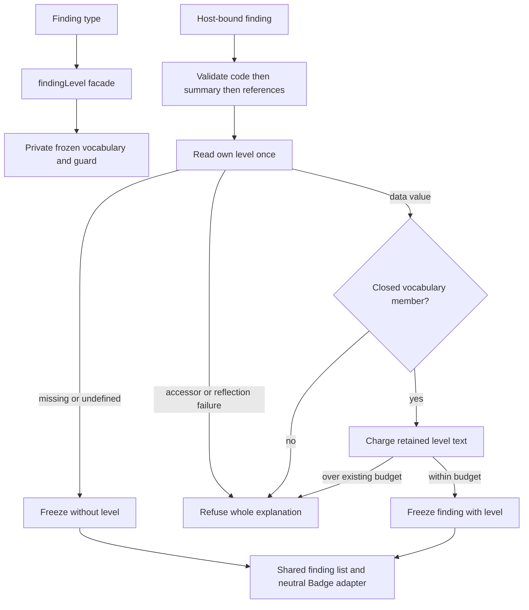

# Failure explanation display

Standalone opt-in view over a host-admitted presentation. `types.ts` owns the UI
projection; `admission.ts` selects detached own data fields; the component renders
canonical wording, optional supplementary business guidance and mandatory
uncertainty. There is no diagnosis, template matching, storage loading, action or
graph selection here. Existing viewers do not change.

The required `canonicalFindings` contains complete causes, consequences and
diagnostic failures, including their codes, summaries and references. Cause
summaries remain in the cause card; its details retain the complete findings.
Other outcomes and recording problems are visibly separate sections, so a
failed recorder is never silently dropped or presented as the business cause.
Configured guidance cannot replace these fields.

The host binds the formatted result to the exact selected recording and item,
and replaces or clears it whenever that selection changes. A producer-formatted
explanation is structurally assignable without a runtime dependency on its producer.
Canonical text is always visible; configured wording does not replace evidence.
Reference strings appear only in disclosure text, never as links or actions.

An empty `unknowns` list describes what was supplied. The verification
disclaimer stays visible. Section text, configured guidance, finding summaries
and unknown items accept either a plain string or a list of parts. In a list,
`{ text: excerpt, quote: true }` identifies a record quotation. The quotation
has a visible boundary, an accessible name and its own whitespace and text
direction. The exact excerpt stays in its DOM text as the browser collapses
visual whitespace. Keep the bound evidence with its original IDs and references.

The entire view is refused when a required field is missing, inconsistent,
accessor-backed or over budget. The limits are 262,144 retained UTF-16 text code
units total, 1,024 entries per list, 4,096 total list items across nested lists
and 4,096 code units per reference or unknown. A parts list counts each slot
and the original length of each part. Refusal keeps
the cause and outcome unknown and tells the host to supply an admitted result.
Every canonical finding code must match `/^[A-Z][A-Z0-9_]{1,79}$/`: 2–80 ASCII
characters, beginning with an uppercase letter and continuing only with uppercase
letters, digits or underscores. Empty codes, lowercase and whitespace are invalid;
an invalid code refuses the whole view.
Only known own data fields are read; unrelated fields, input iterators and input
array methods are ignored. JavaScript Proxy reflection is not sandboxed.

Both standalone panels inherit the existing theme context:

```tsx
import { FailureExplanationView, FootprintTheme, InvestigationPanel, coolLight } from 'footprint-explainable-ui';

<FootprintTheme tokens={coolLight}>
  <FailureExplanationView explanation={selectedExplanation ?? null} />
  <InvestigationPanel port={boundInvestigationPort} />
</FootprintTheme>
```

The explanation remains bound by the host. **Show recorded path** in
`InvestigationPanel` expands the accepted `result.path` references.
`GroupedFlowInvestigation` supplies the diagram composition and includes its own
investigation panel, using returned backward nodes/edges when available. Its
diagram and query must share the exact bound port and opaque node IDs; labels
cannot choose a recording or supply missing relationships.

**Semantic hooks:** the outer labelled section uses
`data-fp="failure-explanation"` in both admitted and refused states. Only admitted
sections have fixed `data-section` values: `problem`, `recordedCause`,
`suggestedNextStep`, `consequences`, `recording` and `unknowns`. Optional sections
remain absent when their content is absent; refusal has no admitted section
markers. Values repeat across instances, so scope lookup to one host container:

```ts
const view = hostElement.querySelector<HTMLElement>('[data-fp="failure-explanation"]');
view?.querySelector<HTMLElement>('[data-section="recordedCause"]')?.scrollIntoView();
```

Markers support finding/scrolling a section only. The unique generated IDs and
`aria-labelledby` relationships remain unchanged; consumers must not depend on
internal ID suffixes. Markers confer no selection authority, focus or repair
execution. They never derive from model text or host IDs.

Adjacent tests cover visible canonical wording/unknowns, supplementary labels,
text escaping, no actions, selection replacement, fixed bounds and inert reads.

Host preflight uses the same parser as this component:

```tsx
import { checkFailureExplanationDisplay, failureExplanationDisplayLimits } from 'footprint-explainable-ui';

const checked = checkFailureExplanationDisplay(rawExplanation);
// The host may log the bounded checked.diagnostic on refusal.
<FailureExplanationView explanation={checked.ok ? checked.value : null} />;
```

The frozen limits expose the existing UTF-16/list ceilings and finding-code
pattern string. Success returns the detached frozen projection and exact
parser-counted text/list usage. Refusal returns one schema-only diagnostic;
there is no partial model or claimed full cost of the unvisited tail. The view
keeps its generic uncertainty/recovery message. No source value, reference,
finding code or foreign error text is copied into a refusal diagnostic.

## Optional host finding levels

Each finding may carry readonly `level: 'HIGH' | 'MEDIUM' | 'LOW' | 'UNVERIFIED'`.
The shared finding list keeps supplied order and duplicates, and shows neutral
`Host level: HIGH` badges through the existing FootprintBadge adapter with part
`failure-finding-level`. A labelled list also says: “Finding levels are supplied
by the host and are not verified by this view.” The value is a host assessment,
not UI confidence, verification, health, a supported root or an evidence reason.
Missing, own-undefined and inherited-only levels add no badge/caption/wrapper or
DTO property; absence never becomes UNVERIFIED. Existing finding text,
references, disclosure, unknowns, IDs and theme behavior remain intact.

`findingLevel.ts` is a sealed facade over one private frozen vocabulary and its
native derived type/guard. No table, helper, new root export or component prop is
public. Types and admission share that vocabulary; admission keeps code,
summary and references first, then reads one own level descriptor. An accessor
refuses without invoking it; invalid members refuse the whole model with the
static level path. Foreign reflection errors keep the existing fixed diagnostic.
Proxy traps remain executable host code, not a sandbox or a time guarantee.

Accepted levels charge their retained UTF-16 length through the existing text
reader after membership validation. Repetitions count again; a scalar adds no
list slot. All existing caps remain fixed. This charge is parser-counted retained
input text, not the badge template, serialized bytes or DOM cost.



Migration: a formerly ignored own invalid/accessor level now refuses, and an
accepted level now consumes text budget. Near-limit models may newly refuse.
Supply a valid host level within the unchanged bounds or remove unsupported
metadata. This intentional change is recorded in the major Migration fragment;
no producer authentication or automatic severity conversion is introduced.
